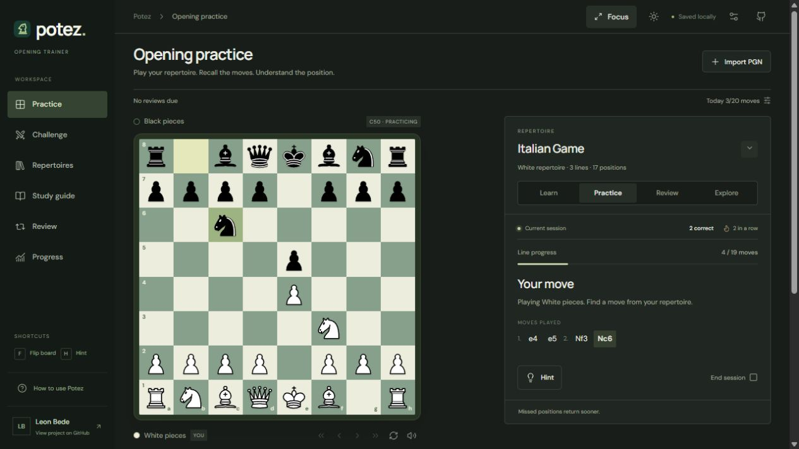
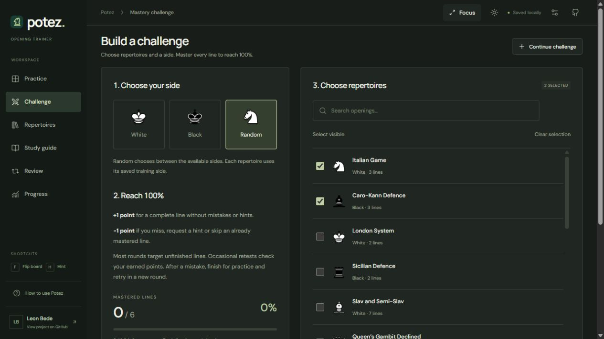

# Potez

A chess opening trainer by [Leon Bede](https://github.com/leonbede7).

Import a PGN, play its variations on the board, and come back to the positions you miss. Everything you import and practice stays in your browser.

[**Open the demo**](https://leonbede7.github.io/potez/) · [How it works](#training-modes) · [Run locally](#run-locally) · [Architecture](docs/ARCHITECTURE.md)

[](https://github.com/leonbede7/potez/actions/workflows/ci.yml)



## Why I made it

I wanted to practice the openings I actually play, using my own PGN files rather than a fixed course. Potez grew from that into a tool for importing a repertoire, learning its branches, and checking whether I can still recall them later.

The project focuses on a usable board, accurate PGN handling, and progress that means something. It does not generate explanations or run an engine while you train.

## Training modes

| Mode      | What you do                                                             |
| --------- | ----------------------------------------------------------------------- |
| Learn     | Follow the next move with an arrow and read comments from the PGN.      |
| Practice  | Recall the moves yourself; opponent replies play automatically.         |
| Review    | Revisit positions that are due according to a simple interval schedule. |
| Explore   | Browse lines, choose recorded alternatives, and save position notes.    |
| Challenge | Mix selected repertoires and master every complete line.                |

### A challenge you can lose progress in

A complete line played without a mistake or hint earns **one point**. If you later miss a move, ask for a hint, or skip that mastered line, its point is removed. You recover it by playing the whole line cleanly in another round.

The challenge ends at **100% of the selected unique lines**, not after a fixed number of rounds. Unfinished lines appear more often, while occasional retests check the points already earned. You can pause and continue another day.

Any recorded continuation from the current position is accepted, including transpositions between selected repertoires. A combined path remains playable, but only a complete original PGN line earns mastery; unseen branches are never marked solved. Exact duplicate lines count once.



## What is included

- PGN files and pasted notation, multiple games, nested variations, comments, initial FENs and underpromotions.
- A 10 MB UTF-8 import limit, worker-based parsing, shared move validation, and tests covering large expanded repertoires.
- Click-to-move and drag-and-drop, board flipping, keyboard shortcuts, light/dark appearance and adjustable sounds.
- A board editor, searchable lines, reversible archiving, PGN exports and JSON backup/restore.
- Four sample repertoires and an optional-to-practice study library: 82 foundation chapters, 36 advanced continuations and 18 decision drills.
- English interface and bundled lessons. Your own PGN text and notes keep their original language.

## Run locally

Requires **Node.js 22+**. Node.js 24 is used for the demo build.

```sh
git clone https://github.com/leonbede7/potez.git
cd potez
npm ci
npm run dev
```

Open the local address printed by Vite.

```sh
npm test                    # rules, imports, training, storage and migrations
npm run build               # production output in dist/
npm run preview             # serve the production build locally
npm run export:repertoires   # regenerate bundled PGNs and study notes
```

For deployment below a subpath, pass a Vite base, for example `npm run build -- --base=/potez/`. The GitHub Actions workflow tests Node.js 22 and 24, then publishes the demo from `main` after both pass. A fork must enable Pages with GitHub Actions as the source.

## Under the hood

**JavaScript · Vite · chess.js · @mliebelt/pgn-parser · IndexedDB · native CSS**

There is no backend or application account. PGN parsing runs in a Web Worker, legal replay uses chess.js, and the training logic is covered by Node’s built-in test runner. See [architecture and design decisions](docs/ARCHITECTURE.md).

The review intervals are 4 hours, then 1, 3, 7, 14 and 30 days. Errors and hints make a position due in one minute. This is a simple scheduler, **not FSRS**.

## Study sources and limits

The library originally followed my public Chess.com opening choices. Advanced lines cite a pinned [Lichess CC0 opening database](https://github.com/lichess-org/chess-openings/tree/712a58be746c143f4ab935b68acc50f4bac813eb) and include actual Stockfish 19 search evidence. The recorded search covers 1,187 unique final positions at at least 3 million nodes per non-terminal position.

After explicitly chosen opening commitments, checked loss is bounded to 0.30 pawns against the best move found at that search budget. That is a finite check, not proof of optimality. The remaining foundation chapters are not all engine-verified. An unrecorded move is not automatically a bad chess move.

[Verification notes](public/repertoires/opening-verification.md) · [Raw evidence](public/repertoires/opening-verification.json)

## Data and privacy

PGNs, notes, practice history and mastery are stored in IndexedDB. They are not uploaded or synchronized between devices. Different browsers and origins have separate stores. Export a JSON backup before clearing browser data or moving devices. Fonts are loaded from Google Fonts; there is no analytics or game-data API in the app.

## Contributing and credits

Bug reports with a short reproducible PGN are especially useful. See [CONTRIBUTING.md](CONTRIBUTING.md).

Original application code: [MIT](LICENSE). The Cburnett chess pieces are separately licensed under GPL-2.0-or-later. Other asset and dependency credits are listed in [THIRD_PARTY_NOTICES.md](THIRD_PARTY_NOTICES.md).
